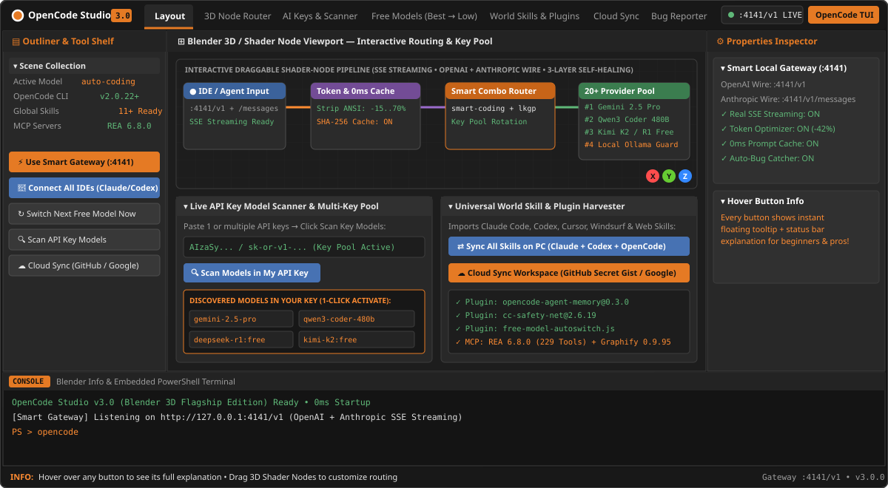

<div align="center">

# OpenCode Studio v3.0 — Blender 3D Flagship Edition

**The All-in-One Native AI Coding Gateway, Multi-Key Pool Router, Live API Key Model Scanner, Universal World Skill/Plugin Harvester & Encrypted Cloud Sync Hub.**

[](https://github.com/vaasiraq-art/opencode-studio/releases/latest)
[](https://github.com/vaasiraq-art/opencode-studio/issues)

<br/>



</div>

---

## Why OpenCode Studio v3.0?

| Feature | OpenCode Studio v3.0 | Traditional Web Proxy Routers |
| :--- | :--- | :--- |
| **Startup & Install Speed** | **`0ms` local startup • Fast unpack `.exe` • `<50 MB` RAM** | Heavy 4–8 GB Node/Next.js web server |
| **User Interface** | **Blender 3D Dark Workspace** (Draggable Shader Nodes, SVG Bezier Wires, 3D Axis Gizmo, Outliner, Inspector, Console) | Multi-page browser dashboard |
| **Instant Button Help** | **Floating Blender Tooltip + Bottom Status Bar explanation on every button** | Hidden docs |
| **Live API Key Model Scanner** | **Paste any API key → Click `Scan Key Models` → Reads & activates all models inside your key** | Manual model ID typing |
| **Multi-Key Pooling** | **Paste multiple free keys per provider → Automatic Round-Robin Key Pool rotation** | Single key bottleneck |
| **Streaming & Protocols** | **Real SSE Streaming (`stream: true`) + OpenAI (`/v1/chat/completions`) + Anthropic (`/v1/messages`)** | Single protocol |
| **Non-Stop Free Failover** | **3-Layer Self-Healing Gateway (`:4141/v1`) + `free-model-autoswitch.js` V2 Plugin** | Stops mid-session on 429 |
| **Universal Skill Harvester** | **Imports skills from Claude Code, Codex, Cursor (`.cursorrules`), Windsurf, GitHub, or any Web URL** | Single-agent format only |
| **Cloud Sign-In & Sync** | **Sign in with GitHub or Google Drive → AES-256-GCM encrypted workspace sync across PCs** | Local machine only |
| **Auto Bug Reporter** | **Captures errors automatically (redacting secrets) for 1-click GitHub Issue submission** | Manual log hunting |

---

## Beginner Guide (Easy 1–2–3 Setup)

### Step 1: Download & Install (Choose Any Drive `C:`, `D:`, `E:`, `F:`)
1. Download **`OpenCode-Studio-Setup-3.0.0.exe`** from [**GitHub Releases**](https://github.com/vaasiraq-art/opencode-studio/releases/latest).
2. Run the installer, review the **Pre-Install Apps & Drivers Checklist**, choose any drive/folder (`C:`, `D:`, `E:`, `F:`), and finish.
3. Double-click the **OpenCode Studio** icon created on your Desktop.

### Step 2: Add a Free API Key & Scan Your Models
1. Click the **AI Keys & Scanner** tab in the top bar.
2. Click **Get Key** on any free provider (such as **Google AI Studio**, **OpenRouter**, **Groq**, **Cerebras**, **SambaNova**, or **Mistral**).
3. Paste your API key and click **🔍 Scan & Read All Models in My API Key**.
4. Click any discovered model chip to activate it immediately!

### Step 3: Code Non-Stop (Automatic Free Model Switching)
- Click **⚡ Use Smart Gateway in OpenCode** on the left shelf, then click **Launch OpenCode TUI**.
- When your active free model's quota finishes (`HTTP 429`), OpenCode Studio automatically switches to the next free coding model in your ranked list so your project keeps building without interruption.
- **Need help with any button?** Just hover your mouse over any button in the app to read a clear explanation in the floating Blender tooltip and bottom status bar!

---

## Pro & Advanced Developer Guide

### 1. Local Multi-Protocol Streaming Gateway (`http://127.0.0.1:4141`)
OpenCode Studio runs an embedded zero-bloat gateway on `127.0.0.1:4141`:
- **OpenAI-Compatible Endpoint:** `POST http://127.0.0.1:4141/v1/chat/completions` (`stream: true` & `stream: false`)
- **Anthropic-Compatible Endpoint:** `POST http://127.0.0.1:4141/v1/messages` (works directly with Claude Code!)
- **Model Discovery Endpoint:** `GET http://127.0.0.1:4141/v1/models`
- **Health & Telemetry Endpoint:** `GET http://127.0.0.1:4141/health`

Click **🔗 Connect All IDEs (:4141/v1)** on the left tool shelf to configure **OpenCode V2** and generate `~/.config/opencode/ide-gateway-env.ps1` for **Claude Code, OpenAI Codex, Cursor, Cline, and Aider**.

### 2. Multi-Account Key Pooling
In the **AI Keys & Scanner** tab, you can paste **multiple API keys** (one per line or comma-separated) for any provider. The gateway automatically rotates across your key pool on every request before failing over to the next provider tier.

### 3. Universal World Skill & Plugin Harvester
In the **World Skills & Plugins** tab:
- Paste any GitHub repo (`owner/repo`), raw web URL (`SKILL.md`, `CLAUDE.md`, `AGENTS.md`, `.cursorrules`, `.mdc`), or raw prompt text to convert and install it across **OpenCode**, **Claude Code** (`~/.claude/skills`), **Codex** (`~/.codex/skills`), and **Gemini** (`~/.gemini/config/skills`).
- Click **⇄ Sync All Skills on PC** to unify every skill installed across all coding agents on your machine.
- Install any OpenCode plugin via the **Universal Plugin Installer** (includes an automatic V1→V2 compatibility bridge).

### 4. Encrypted Cloud Sync Across PCs (GitHub & Google Drive)
Open the **Cloud Sync** tab:
1. Sign in with **GitHub** (syncs to a secret private Gist on your GitHub account) or **Google** (syncs to your Google Drive / OneDrive folder).
2. Enter an optional **Encryption Passphrase** (uses PBKDF2 + **AES-256-GCM** to encrypt your API keys).
3. Click **☁ Save Work to Cloud Now** on PC #1, and click **⬇ Restore Work from Cloud** on PC #2.

### 5. Build from Source
```bat
git clone https://github.com/vaasiraq-art/opencode-studio.git
cd opencode-studio
npm install
npm start
```

To build the fast-unpack Windows `.exe` installer:
```bat
npm run dist
```

---

## License & Community Contributions

Licensed under the **OpenCode Studio Community & Maintainer-Deployed License (`LICENSE`)**:
- **Download & Use:** Free for everyone to download, install, and use.
- **Auto Bug Reports & Issues:** Users and coders can submit bug reports directly from the in-app **Bug Reporter** tab (all API keys are automatically redacted) or at [GitHub Issues](https://github.com/vaasiraq-art/opencode-studio/issues).
- **Edit & Contribute:** Coders may fork and edit the code locally and open Pull Requests; official releases and deployments on GitHub are reviewed and published by **@vaasiraq-art**.
