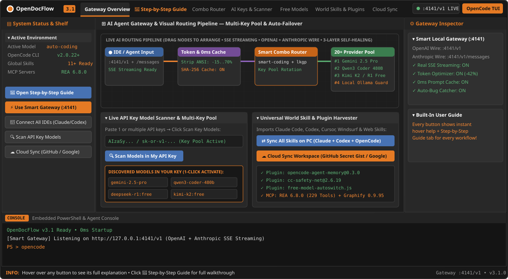
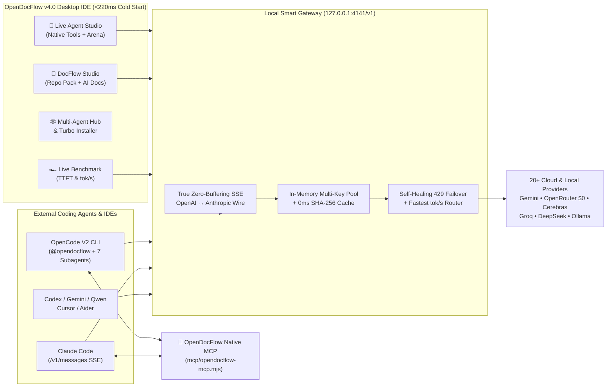

<div align="center">

# ⚡ OpenDocFlow v4.0

### Autonomous AI Agent Studio • Multi-Agent CLI Hub • DocFlow Repo Packager & AI Docs • 1-Click MCP Marketplace • True-SSE Smart Gateway (`:4141/v1`)

[](https://github.com/vaasiraq-art/OpenDocFlow/releases/latest)
[](https://github.com/vaasiraq-art/OpenDocFlow/actions)
[](https://github.com/vaasiraq-art/OpenDocFlow/releases/latest)
[](#performance--zero-freeze-architecture)

<p align="center">
  
</p>

[**⬇ Download OpenDocFlow v4.0 Setup & Portable `.exe`**](https://github.com/vaasiraq-art/OpenDocFlow/releases/latest) · [**📘 60-Second Quickstart**](#-60-second-quickstart) · [**🤖 `@opendocflow` Agent & MCP**](#-opendocflow-as-a-native-agent--mcp-server) · [**🐞 Report Issue**](https://github.com/vaasiraq-art/OpenDocFlow/issues)

</div>

---

## 🚀 What's New in OpenDocFlow v4.0 (Major Overhaul)

OpenDocFlow v4.0 transforms your desktop into a **zero-lag, multi-agent AI engineering command center**—combining an autonomous in-app coding agent, **OpenCode V2** integration, external CLI coding agents, live repository context packaging, AI documentation generation, and a **zero-buffering SSE multi-protocol gateway**:

| Capability | OpenDocFlow v4.0 | Typical Single-Agent Wrappers |
| :--- | :--- | :--- |
| **Built-In Live Agent Studio** | Autonomous file read/search/write tools + **OpenCode V2** + **Dual-Model Side-by-Side Arena** | Chat-only or single CLI |
| **`@opendocflow` Everywhere** | 1-click installs `@opendocflow` + **7 Specialist Subagents** + **6 Slash Commands** + **Native Stdio MCP Server** into OpenCode V2 & Claude Code | Manual JSON editing |
| **Multi-Agent CLI Hub** | Detect, Turbo-install & launch **OpenCode V2, Claude Code, OpenAI Codex, Google Gemini CLI, Qwen Code, Aider & Ollama** pre-wired to `:4141` | Locked to 1 vendor |
| **True Zero-Buffering SSE Gateway** | `0ms` first-token streaming on `:4141/v1/chat/completions` **and** Anthropic `/v1/messages` (including `tools` / `tool_use`!) | Buffered or OpenAI-only |
| **DocFlow Repo & AI Docs Studio** | `.gitignore`-aware Repo-to-Markdown packager (secret-redacted + token estimator) + 1-click `README.md`, Mermaid `ARCHITECTURE.md`, `DOCS.md` & `CHANGELOG.md` | External scripts needed |
| **Live Speed Benchmark (`tok/s`)** | Parallel provider benchmark measuring real **TTFT (`ms`)** & **`tok/s`** + 1-click **Auto-Sort Combo Chain by Fastest** | Guesswork |
| **1-Click MCP Marketplace** | 12 curated MCP servers (`opendocflow`, `context7`, `playwright`, `rea` 229-tool RE suite, `graphify-mcp`, `github`, `filesystem`, `memory`, `sqlite`…) | Manual `npx` paths |
| **Startup & Installer Speed** | `<220ms` GPU-accelerated launch + **Turbo Parallel Installer** (supports portable drives `C:/D:/E:/F:`) | Sequential blocking installs |

---

## 🏗 System Architecture



---

## 🤖 `@opendocflow` as a Native Agent + MCP Server

Click **⚡ 1-Click Install `@opendocflow` Suite + MCP** inside **Multi-Agent Hub** to register the complete OpenDocFlow intelligence suite across **OpenCode V2** (`~/.config/opencode/opencode.jsonc`) and **Claude Code** (`~/.claude/agents/*.md`):

### 8-Agent Specialist Team
- **`@opendocflow`** *(Primary Autonomous Orchestrator)* — Full-stack architecture, implementation, verification & documentation.
- **`@architect`** *(Read-Only)* — System design, API contracts, data models & Mermaid diagrams.
- **`@coder`** — High-velocity feature implementation & surgical refactoring.
- **`@debugger`** — Root-cause analysis, race-condition/hang elimination & stack-trace forensics.
- **`@docflow`** — Generates world-class `README.md`, `ARCHITECTURE.md`, `DOCS.md` & `CHANGELOG.md`.
- **`@security`** *(Read-Only)* — Secret leak scanning, OWASP/auth/IPC hardening & dependency audits.
- **`@reverse-engineer`** *(Read-Only)* — Binary, APK, Electron & protocol inspection (pairs with REA 229-tool MCP).
- **`@graph-navigator`** *(Read-Only)* — Code knowledge-graph traversal for 80% lower token consumption.

### Native OpenDocFlow MCP Server (`mcp/opendocflow-mcp.mjs`)
Zero-dependency `<5ms` stdio JSON-RPC 2.0 MCP server exposing **6 tools** to any MCP-compatible IDE or CLI:
1. `opendocflow_gateway_status` — Live `:4141/v1` telemetry, active model, cache hits & per-provider `tok/s`.
2. `opendocflow_rotate_model` — Instantly rotate your `free-fallback-chain.json` when rate-limited.
3. `opendocflow_pack_repository` — Pack any local repo into secret-redacted LLM Markdown with token stats.
4. `opendocflow_list_skills` — Discover all universal skills installed across `~/.config/opencode/skills` & `~/.agents/skills`.
5. `opendocflow_read_skill` — Load any `SKILL.md` on demand.
6. `opendocflow_ask_specialist` — Delegate sub-problems to `@architect`, `@security`, `@debugger`, or `@docflow` through `:4141/v1`.

---

## ⚡ Performance & Zero-Freeze Architecture

Every bottleneck that caused lag or hangs in v3.x has been engineered out:
1. **True Upstream SSE Streaming (`0ms` Buffering):** `lib/gateway-benchmark.js` pipes chunked `text/event-stream` bytes directly from upstream providers to OpenCode V2, Claude Code, and Agent Studio with live Time-To-First-Token (`TTFT`) and `tok/s` calculation.
2. **Hardware GPU Acceleration + Watchdog:** GPU compositing stays enabled by default for 60fps scrolling and animations, backed by an automatic `child-process-gone` crash watchdog (`Safe GPU Mode` toggle available in Turbo Installer).
3. **Instant `<220ms` Window Reveal & Lazy Tab Hydration:** Boot runs zero blocking network fetches and never interrupts you with startup popups.
4. **In-Memory Vault & Config Caching + Async Debounced Telemetry:** Gateway routing reads pooled keys in `0ms` from memory and writes telemetry asynchronously off the hot path.
5. **Full-PATH + Portable Drive Resolver & Clean Process-Tree Termination:** Automatically discovers tools across full Windows `PATH` plus portable drives (`D:\apps\MY ai Agent`, `C:\`, `E:\`, `F:\`) and cleanly kills spawned process trees via `taskkill /T /F`.

---

## 🏁 60-Second Quickstart

### Option A — Download Prebuilt Windows Release (Recommended)
1. Grab **`OpenDocFlow Setup 4.0.0.exe`** (customizable drive installer) or **`OpenDocFlow-Portable-4.0.0.exe`** (zero-install single executable) from [**Releases**](https://github.com/vaasiraq-art/OpenDocFlow/releases/latest).
2. Open **🔑 AI Keys & Scanner** and paste 1 or more free API keys (one per line for automatic rotation) from **Google AI Studio**, **OpenRouter**, **Groq**, or **Cerebras** — or run local **Ollama**.
3. Open **⚡ Gateway & Benchmark** → click **🏆 Benchmark & Auto-Sort Fastest**.
4. Open **🕸 Multi-Agent Hub** → click **⚡ 1-Click Install `@opendocflow` Suite + MCP**, then start building in **🤖 Agent Studio** or click **▶ Launch OpenCode**!

### Option B — Run or Build from Source
```powershell
git clone https://github.com/vaasiraq-art/OpenDocFlow.git
cd OpenDocFlow
npm install
npm start          # Launch OpenDocFlow v4.0 in <220ms
npm run dist       # Build NSIS Setup + Portable .exe in dist/
```

---

## 🔒 Security & Privacy
- **100% Local Vault:** API keys are stored strictly on your machine (`%APPDATA%/opendocflow/studio-data/keys/*.key`) and never committed to git.
- **Automatic Secret Redaction:** DocFlow Repo Packager and the 1-Click GitHub Bug Reporter scrub `sk-*`, `ghp_*`, `github_pat_*`, `AIza*`, `gsk_*`, and Bearer tokens automatically.
- **End-to-End Encrypted Cloud Sync:** Optional GitHub Secret Gist / Drive sync encrypts your key vault locally with **PBKDF2-SHA256 (100,000 iterations) + AES-256-GCM** before upload.

---

## 📄 License
See [LICENSE](LICENSE). Built with ❤️ by [@vaasiraq-art](https://github.com/vaasiraq-art).
